<div align="center">
  
  <h1>Spendly</h1>
  <p><strong>Local-first expense tracking with ten complete themes and four currencies.</strong></p>
  <p>Plan monthly budgets, log expenses, and review spending history in your browser or as a native Windows app.</p>
</div>

<p align="center">
  <a href="https://github.com/robolivice/spendly/stargazers">
    
  </a>
  <a href="https://github.com/robolivice/spendly/releases">
    
  </a>
  <a href="LICENSE">
    
  </a>
</p>

<p align="center">
  
  
  
  
</p>

<p align="center">
  <a href="#features">Features</a> &middot;
  <a href="#themes">Themes</a> &middot;
  <a href="#quick-start">Quick start</a> &middot;
  <a href="#desktop-app">Desktop app</a> &middot;
  <a href="#build-from-source">Build from source</a> &middot;
  <a href="#project-layout">Project layout</a> &middot;
  <a href="CHANGELOG.md">Changelog</a> &middot;
  <a href="#license">License</a>
</p>

---

## Features

Spendly does one job well: making a monthly budget easy to live with. Everything stays on your machine, works offline, and adapts to the way you think about a budget period.

- **Multiple profiles** for separate budgets, accounts, or people. Create, rename, switch, and delete profiles without mixing their data.
- **Flexible budget cycles.** Start with any date range, then let Spendly generate future periods from the cycle end day. Month-end dates are handled correctly, including February.
- **Limits that make sense.** Set an optional limit per period, inherit the latest limit into new periods, and see spent, remaining, and pacing status at a glance.
- **Focused expense entry.** Record a date, category, amount, and optional description. Sort the transaction table by date, category, amount, or description, edit any entry in place, and undo deletions from a toast.
- **Search that stays close.** Filter the current period as you type, or search descriptions, categories, dates, and amounts across the current period or all saved data.
- **Spending insights.** See a category donut, compare cumulative spending with the ideal pace, and check safe-to-spend per day, daily burn rate, projected total, and days left in the period.
- **Custom categories and budgets.** Add, rename, recolor, or remove categories from Settings, and set an optional budget for each one. Existing expenses are adopted into the category list automatically.
- **Currency-aware totals.** Choose INR, USD, EUR, or GBP in Settings. Every amount, limit, history row, and search result uses the selected currency and locale formatting.
- **Settings in one place.** Manage saved periods and cycle settings, organize categories and budgets, pick a currency, switch themes, and control desktop update checks from a single page.
- **History worth reviewing.** Browse saved periods by year, compare spending against limits, and see which months finished on track, near the limit, or over budget.
- **Ten complete themes.** Switch between light and dark interfaces with distinct layouts, typography, and component styling. Every theme is responsive and available from the built-in gallery.
- **Local-first and private.** No account, no cloud, and no telemetry. The web app makes no outbound network requests; desktop update checks are opt-in. The app binds to `127.0.0.1` only and stores everything in SQLite.
- **Desktop-ready.** The Windows build adds single-instance behavior, remembered window geometry, CSV export, validated database imports, safety backups, and a fully offline installer.

## Themes

Ten themes ship with Spendly, and each one is a complete visual system rather than a color swap. Every screenshot below was captured from the running app.

Use the theme picker in the header, or open **Theme gallery** (the palette icon) to search, filter, and preview each theme. The choice is remembered per browser and survives desktop restarts. Choose **System** to follow your operating system's light or dark preference, which maps to Light SaaS and Dark Fintech. Click any screenshot to open it full size.

| Theme | Desktop | Mobile |
| :--- | :---: | :---: |
| **Dark Fintech** <br> *Default theme* <br><br> Layered ink surfaces and indigo accents. <br><br> `Dark` &middot; `Top nav` &middot; `Indigo` | <a href="Spendly/static/img/themes/fintech-desktop.jpg">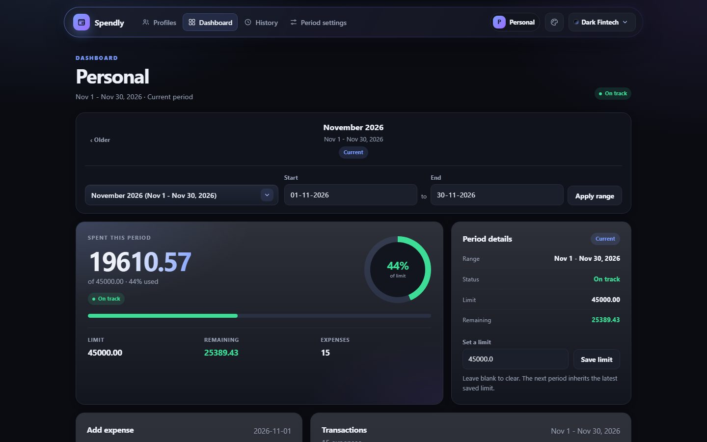</a> | <a href="Spendly/static/img/themes/fintech-mobile.jpg">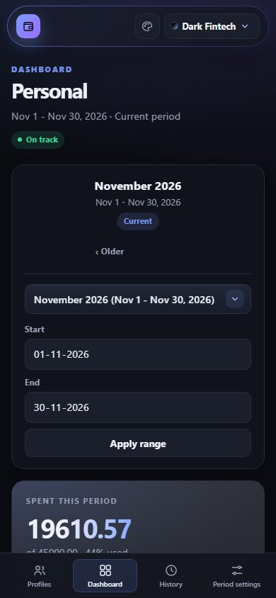</a> |
| **Budget Cockpit** <br><br> A dense telemetry grid with a sidebar cockpit. <br><br> `Dark` &middot; `Sidebar` &middot; `Dense grid` | <a href="Spendly/static/img/themes/cockpit-desktop.jpg">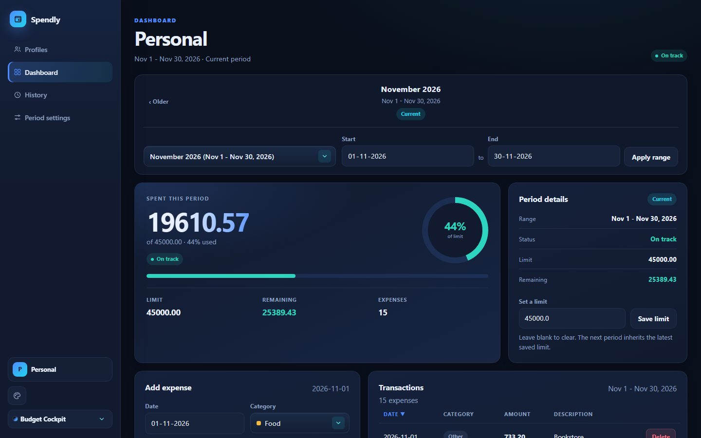</a> | <a href="Spendly/static/img/themes/cockpit-mobile.jpg">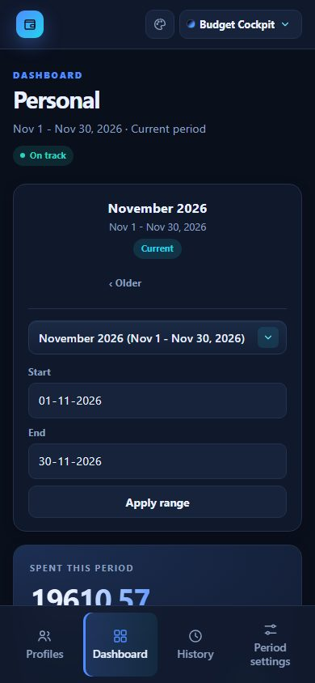</a> |
| **Light SaaS** <br><br> White cards, soft shadows, and airy spacing. <br><br> `Light` &middot; `Top nav` &middot; `Soft cards` | <a href="Spendly/static/img/themes/saas-desktop.jpg">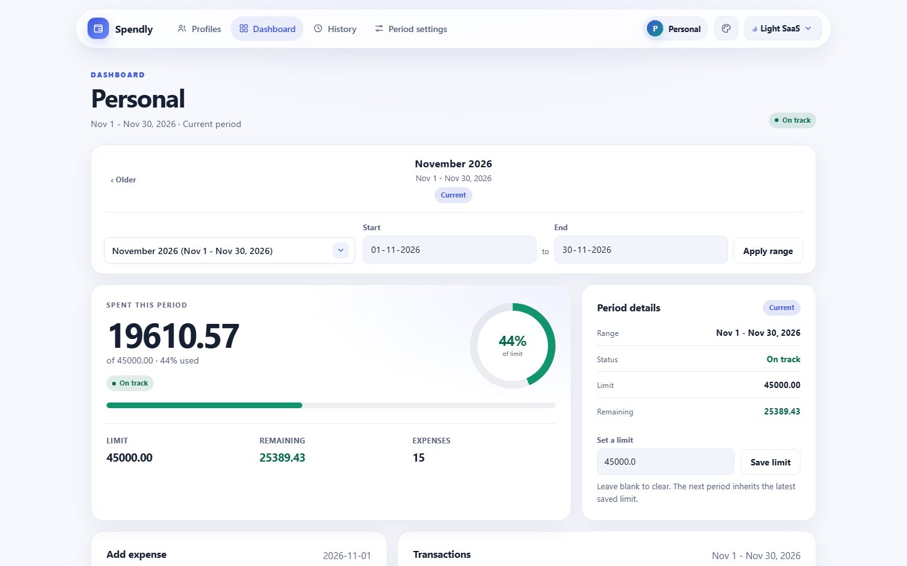</a> | <a href="Spendly/static/img/themes/saas-mobile.jpg">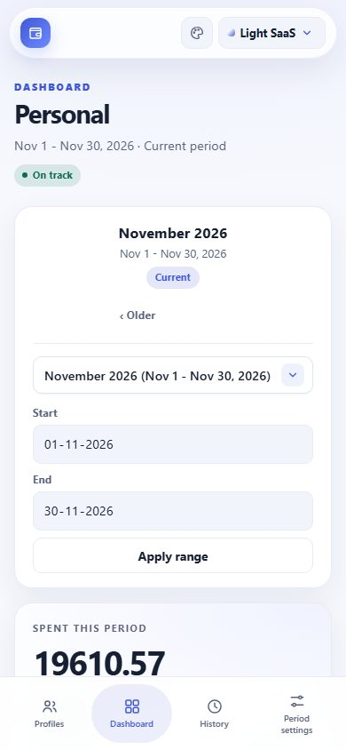</a> |
| **Neon Glass** <br><br> Frosted panels with violet and cyan glow. <br><br> `Dark` &middot; `Floating nav` &middot; `Glass` | <a href="Spendly/static/img/themes/glass-desktop.jpg">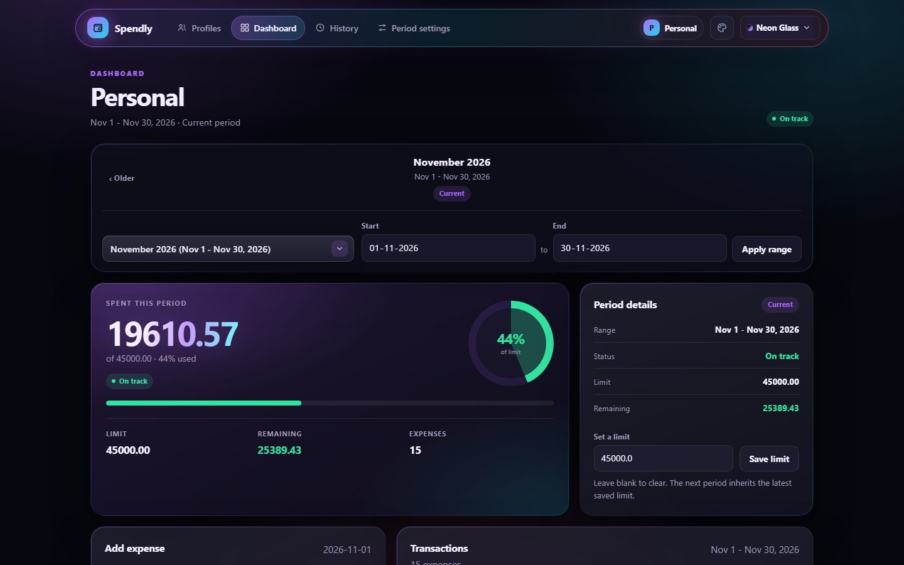</a> | <a href="Spendly/static/img/themes/glass-mobile.jpg">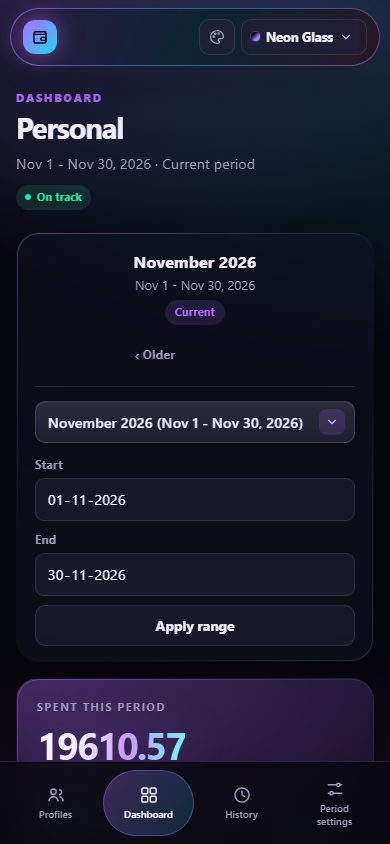</a> |
| **Paper Ledger** <br><br> Ruled paper, ink green, and monospaced figures. <br><br> `Light` &middot; `Top nav` &middot; `Serif` | <a href="Spendly/static/img/themes/paper-desktop.jpg">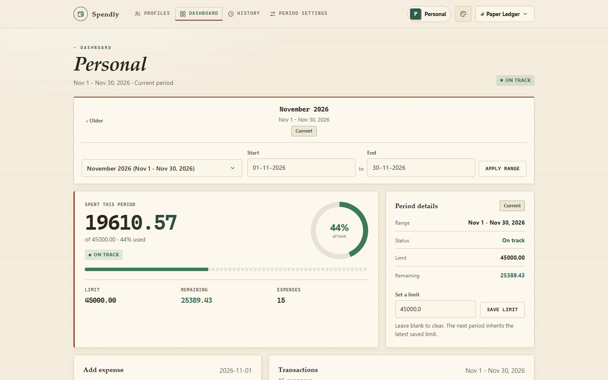</a> | <a href="Spendly/static/img/themes/paper-mobile.jpg">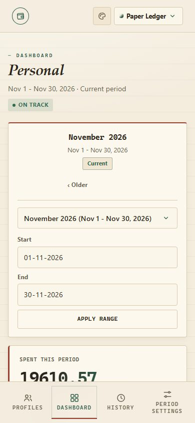</a> |
| **Neo Brutal** <br><br> Thick outlines, hard shadows, unapologetic yellow. <br><br> `Light` &middot; `Top nav` &middot; `Hard shadows` | <a href="Spendly/static/img/themes/brutal-desktop.jpg">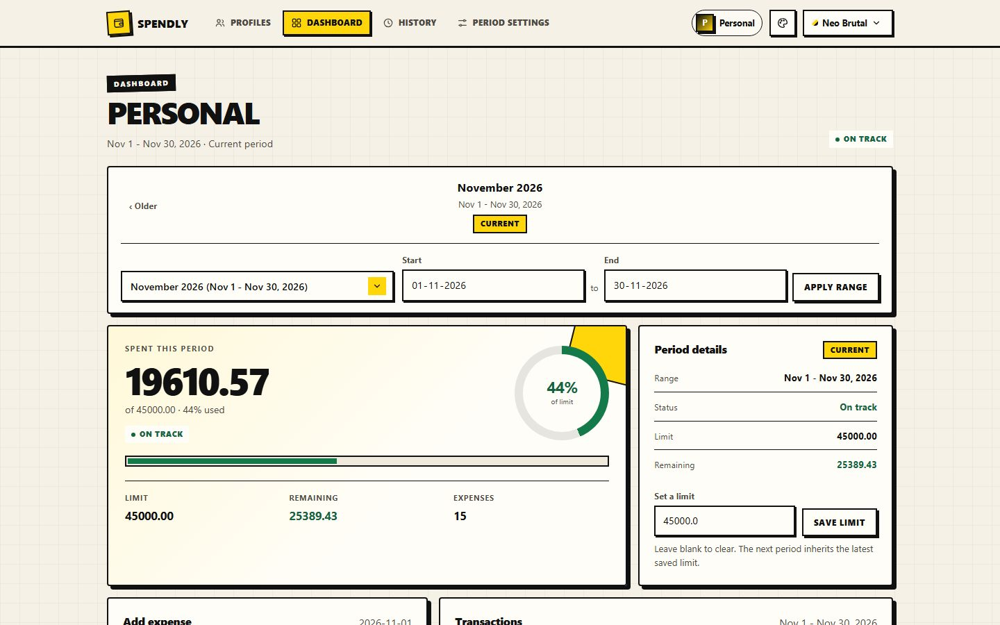</a> | <a href="Spendly/static/img/themes/brutal-mobile.jpg">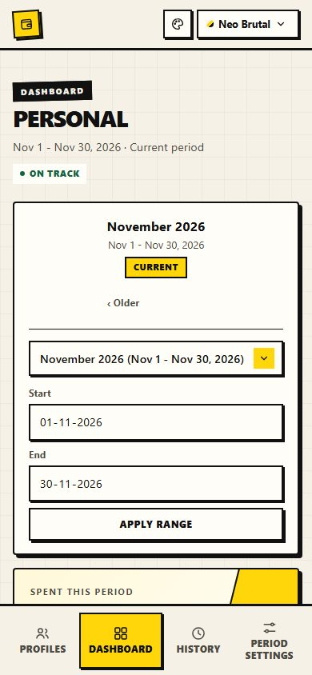</a> |
| **Midnight Gold** <br><br> Near-black lounges and champagne gold. <br><br> `Dark` &middot; `Top nav` &middot; `Dark luxury` | <a href="Spendly/static/img/themes/midnight-desktop.jpg">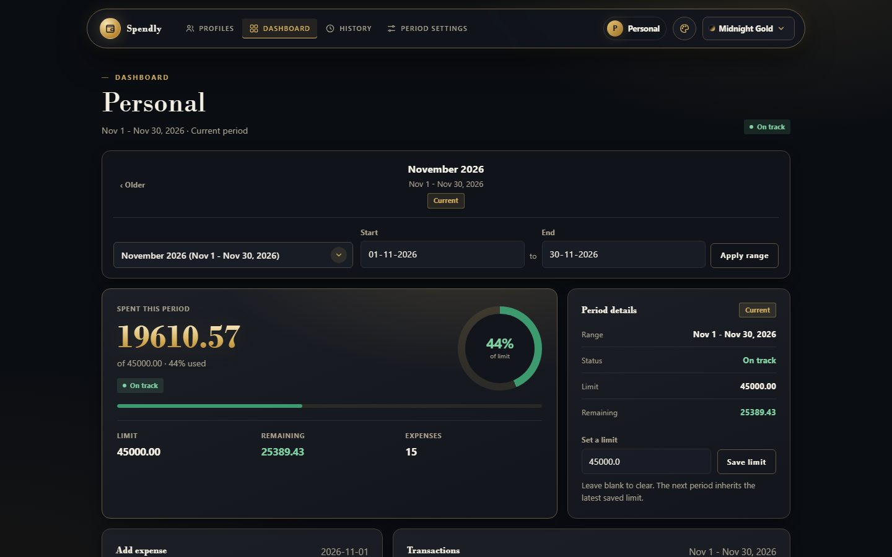</a> | <a href="Spendly/static/img/themes/midnight-mobile.jpg">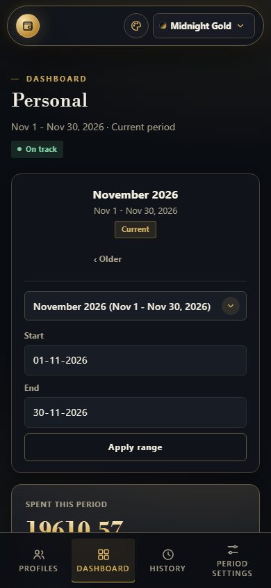</a> |
| **Arctic Aurora** <br><br> Polar night lit by mint and periwinkle ribbons. <br><br> `Dark` &middot; `Top nav` &middot; `Glass` | <a href="Spendly/static/img/themes/aurora-desktop.jpg">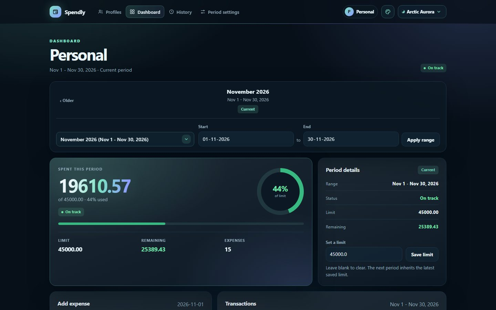</a> | <a href="Spendly/static/img/themes/aurora-mobile.jpg">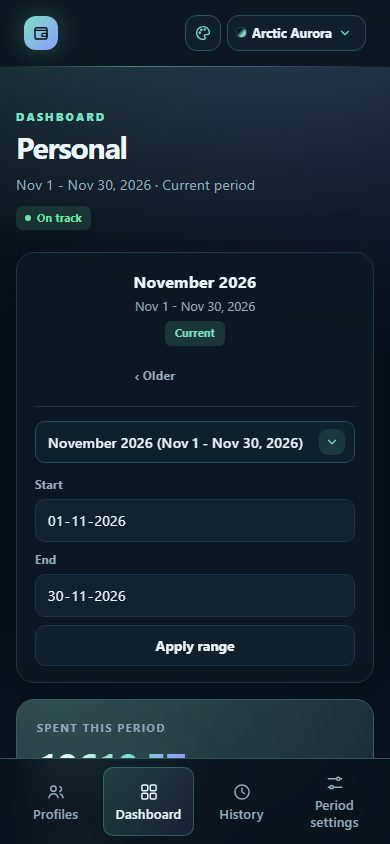</a> |
| **Ember** <br><br> Charred browns and live orange heat. <br><br> `Dark` &middot; `Top nav` &middot; `Warm dark` | <a href="Spendly/static/img/themes/ember-desktop.jpg">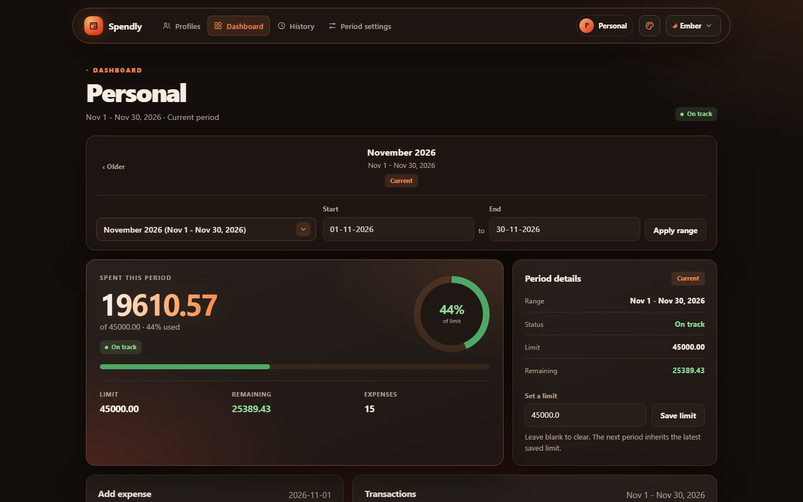</a> | <a href="Spendly/static/img/themes/ember-mobile.jpg">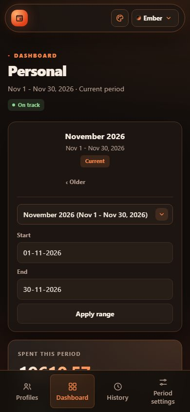</a> |
| **Desert Clay** <br><br> Sun-baked sand, terracotta, and sage. <br><br> `Light` &middot; `Top nav` &middot; `Earthy` | <a href="Spendly/static/img/themes/clay-desktop.jpg">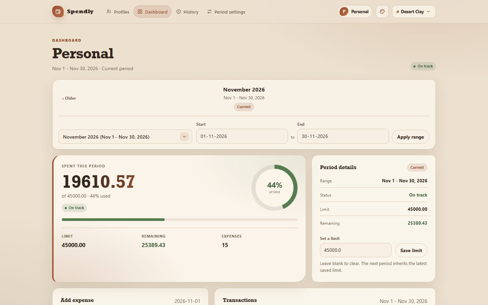</a> | <a href="Spendly/static/img/themes/clay-mobile.jpg">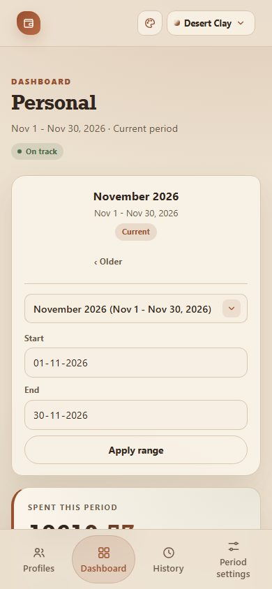</a> |

## Quick start

### Run the web app

**Requires Python 3.10 or newer.** Spendly is developed and tested on Python 3.14.7.

```powershell
git clone https://github.com/robolivice/spendly.git
cd spendly
python -m venv .venv
.venv\Scripts\Activate.ps1
python -m pip install -r Spendly/requirements.txt
python Spendly/app.py
```

Open <http://127.0.0.1:5000>. On macOS or Linux, activate the environment with `source .venv/bin/activate` instead.

On first run:

1. Create a profile.
2. Set the first period's start and end dates and an optional monthly limit.
3. Add expenses from the dashboard and review saved periods in **History**.

To keep test data separate from your real data, point Spendly at another folder:

```powershell
$env:SPENDLY_DATA_DIR = "C:\tmp\spendly-data"
python Spendly/app.py
```

### Run the desktop app from source

```powershell
python -m pip install -r Spendly/requirements-dev.txt
python Spendly/desktop.py
```

Set the `SPENDLY_DEBUG` environment variable to `1` for DevTools, console logging, and the right-click menu.

## Desktop app

Prebuilt 64-bit Windows releases are available on the [Releases page](https://github.com/robolivice/spendly/releases/latest).

| Build | Description |
| :--- | :--- |
| **Installer** (`Spendly-<version>-Setup.exe`) | Recommended for most people on 64-bit Windows 10 or 11. Per-user install to `%LOCALAPPDATA%\Programs\Spendly`, a Start Menu shortcut, and an optional desktop shortcut. The installer is fully offline and bundles the WebView2 runtime installer, so it is about 221 MB. |
| **Portable** (`Spendly-<version>-portable.zip`) | Extract and run `Spendly.exe`. The database, backups, settings, and logs stay in `data\` beside the executable. About 17 MB. |

The desktop build wraps the same Flask app in a native pywebview window and adds:

- Single-instance behavior. Launching Spendly again focuses the running window.
- Remembered window size and position.
- **Export CSV** and **Import database** actions in the header.
- Optional update checks against GitHub releases, with a themed update banner, download progress, SHA-256 verification, and automatic restart after installation. Portable builds keep their `data\` folder.
- Foreground native dialogs for import confirmation, rejection, success, and export results.
- Startup database snapshots in `backups\`, with the newest 10 kept.
- Schema validation before an import replaces anything. Extra tables and columns are allowed, so databases from newer Spendly versions remain compatible.
- A pre-import backup and automatic restore if a copy fails.
- Rotating logs and import history for troubleshooting.

### Where your data lives

All modes keep their state in one data directory:

| Mode | Data location |
| :--- | :--- |
| Installed app | `%LOCALAPPDATA%\Spendly\` |
| Portable app | `data\` next to `Spendly.exe` |
| Web app from source (Windows) | `%LOCALAPPDATA%\Spendly\` |
| Web app from source (macOS) | `~/Library/Application Support/Spendly/` |
| Web app from source (Linux) | `$XDG_DATA_HOME/Spendly/` or `~/.local/share/Spendly/` |

Override the location with the `SPENDLY_DATA_DIR` environment variable. Uninstalling Spendly leaves your data in place.

Spendly never binds beyond `127.0.0.1`. The web app makes no outbound network requests. The desktop app contacts GitHub only when you enable automatic update checks or click the update button; you can turn automatic checks off at any time. No analytics or telemetry are used. Release builds are unsigned, so Windows SmartScreen may show an "Unknown publisher" warning.

## Build from source

The packaging pipeline targets Windows. Build the executable, portable zip, and installer with:

```powershell
powershell -ExecutionPolicy Bypass -File build/build.ps1
```

The build script installs development dependencies, packages the app with PyInstaller, creates the portable archive, and compiles both Inno Setup installers when Inno Setup 6 is installed. It also downloads the WebView2 Evergreen Standalone Installer when needed.

| Output | Contents |
| :--- | :--- |
| `dist/Spendly/Spendly.exe` | One-folder application build |
| `dist/Spendly-<version>-portable.zip` | Portable build with data stored beside the executable |
| `dist/Spendly-<version>-Setup.exe` | Offline Windows installer with the WebView2 runtime |
| `dist/Spendly-<version>-Update.exe` | Lite installer used by in-app updates |

Individual steps can be skipped with `-SkipVenv`, `-SkipIcon`, or `-SkipInstaller`.

## Project layout

```text
Spendly/
|-- app.py               Flask routes and page rendering
|-- desktop.py           pywebview host, CSV export, database import
|-- updates.py           GitHub release checks, downloads, and updates
|-- db.py                SQLite schema and queries
|-- currency.py          Currency definitions and amount formatting
|-- cycles.py            Budget period calculations
|-- migration.py         First-run import, validation, backups
|-- theme_catalog.py     Theme definitions and metadata
|-- paths.py             Version, data, resource, and log locations
|-- settings.py          Persistent settings, update preferences, and window state
|-- requirements.txt     Runtime dependencies
|-- requirements-dev.txt Development and build dependencies
|-- templates/           Jinja pages
|-- static/
|   |-- themes/          Per-theme stylesheets
|   |-- img/themes/      Desktop and mobile theme screenshots
|   `-- js/              Theme, gallery, dashboard, and update behavior
|-- tests/               Updater unit tests
`-- assets/              Application icon and logo
build/                   PyInstaller, portable, and Inno Setup build files
CHANGELOG.md             Release history
LICENSE                  MIT License
```

## Tech stack

| Layer | Technology |
| :--- | :--- |
| Runtime | Python 3.10+ (developed and built on 3.14.7) |
| Web framework | Flask 3.1, Jinja2 |
| Frontend | HTML5, CSS3, vanilla JavaScript |
| Storage | SQLite in WAL mode |
| Desktop shell | pywebview 6.2 with Microsoft Edge WebView2 |
| Packaging | PyInstaller 6.22, Inno Setup 6.7 |

## License

Spendly is released under the [MIT License](LICENSE).

Copyright &copy; 2026 robolivice.
